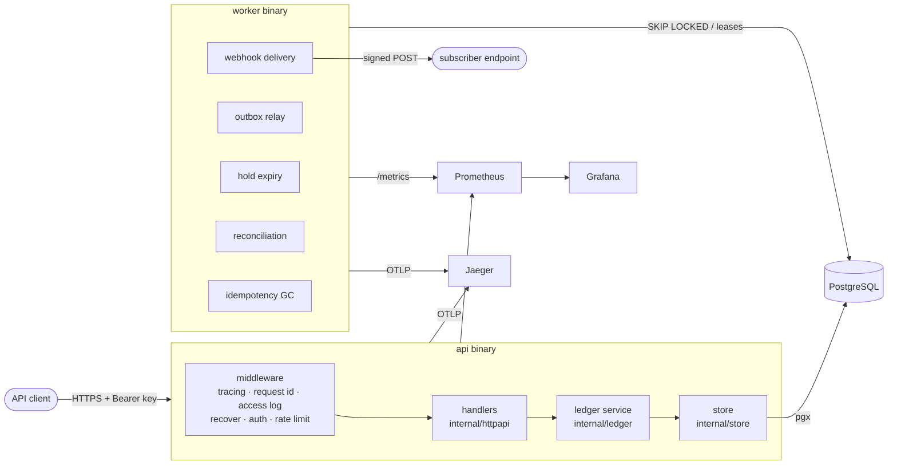
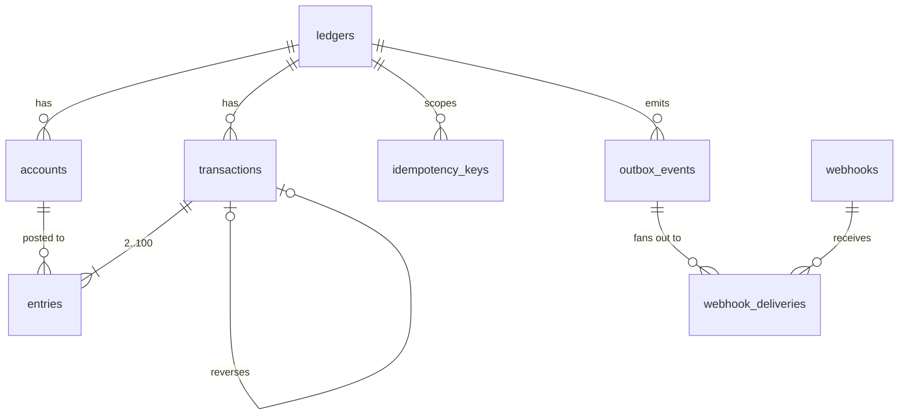
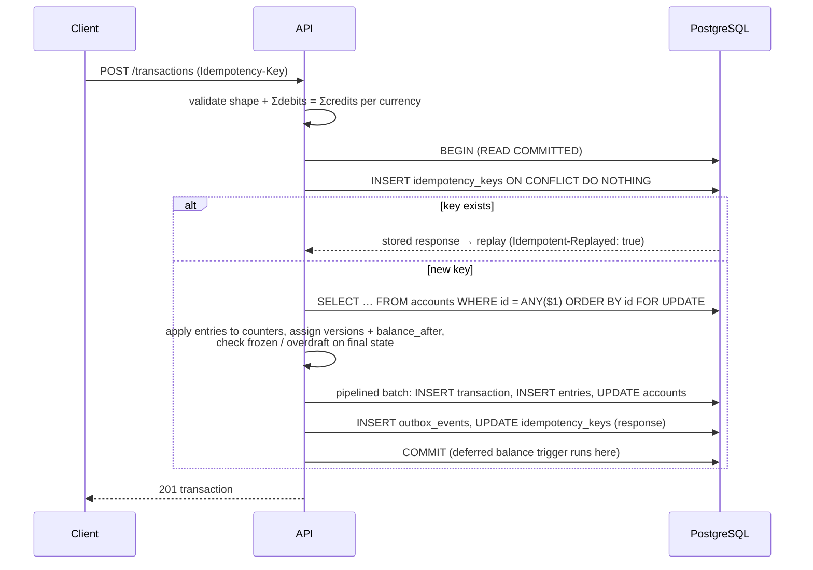
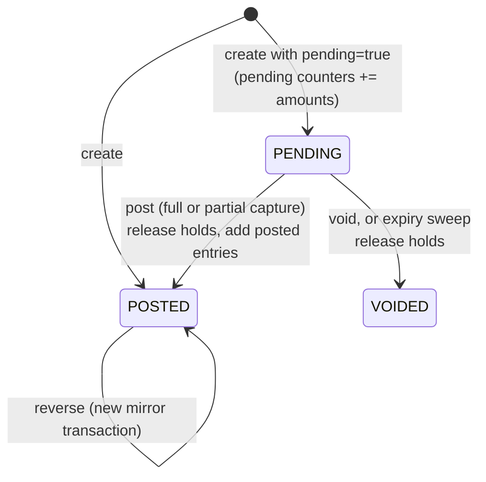

# Architecture

## Components

| Package | Responsibility |
|---|---|
| `internal/money` | Overflow-checked `int64` minor-unit amounts, JSON-as-string encoding |
| `internal/domain` | Types, accounting rules (normal balances, available balance, overdraft), request validation, typed errors. No I/O. |
| `internal/store` | SQL. Row locking, pipelined writes, reconciliation and trial-balance queries, constraint-to-error mapping |
| `internal/ledger` | Use cases and transaction boundaries: posting, holds, reversals, batches, idempotency, events |
| `internal/httpapi` | Routing, auth, rate limiting, problem+json errors, pagination |
| `internal/auth` | API keys (hashed), scopes, ledger scoping |
| `internal/webhook` | HMAC signing, SSRF-safe client, delivery with retries |
| `internal/worker` | Background job loops |

## Data model

* **entries** is the append-only journal, which is the source of truth. Each entry
  stores `account_version` (1, 2, 3… per account, with no gaps) and
  `balance_after` (the account's posted balance after that entry).
* **accounts** caches four counters (`posted_debits`, `posted_credits`,
  `pending_debits`, `pending_credits`) and the `version`. They are updated in
  the same database transaction as the entries, so they are always consistent with
  the journal. The reconciliation job verifies this independently.
* Signed balances are derived from the counters on the account's normal side:
  debit-normal for ASSET and EXPENSE, credit-normal for the other types.
  `available = posted − outgoing holds`.

## Posting a transaction

Retries: serialization failures and deadlocks (`40001`, `40P01`) are retried
from scratch with jittered exponential backoff. Deterministic lock ordering makes
deadlocks impossible in practice, so this is only a safety net.

## Invariants and where they are enforced

| Invariant | Application | Database |
|---|---|---|
| Σ debits = Σ credits per currency (pending and posted separately) | `domain.ValidateEntries` | deferred constraint trigger `entries_balanced` |
| Entry currency and ledger match the account | `applyEntries` | composite FK `(account_id, ledger_id, currency)` |
| No overdraft unless `allow_negative` | `Account.CheckAvailable` | `CHECK accounts_non_negative_available` |
| History is immutable | the code only ever inserts | triggers reject UPDATE/DELETE/TRUNCATE on entries; transactions may only go PENDING → POSTED/VOIDED |
| At most one reversal per transaction | `ReversedByID` check | `UNIQUE (reverses_id)` |
| Counters = Σ journal, versions gapless | `ApplyWrite` in one DB transaction | `UNIQUE (account_id, account_version)`; reconciliation job |
| A request executes at most once per idempotency key | `idempotent()` | `PRIMARY KEY (ledger_id, key)` |

## Two-phase transfers

## Background jobs

Every job is safe to run on several worker replicas because work is claimed
with `FOR UPDATE SKIP LOCKED` or a lease, never through in-process coordination.

| Job | Mechanism |
|---|---|
| Hold expiry | claims one expired PENDING transaction per DB transaction with SKIP LOCKED, then voids it |
| Outbox relay | one statement: claim events (SKIP LOCKED) → insert a delivery per subscribed webhook → mark them published |
| Webhook delivery | lease due deliveries, POST outside any DB transaction, record the result; backoff is computed on the DB clock |
| Reconciliation | recomputes all counters and versions from the journal and exports `ledger_reconciliation_drift_accounts` |
| Idempotency GC | deletes keys older than 24h in bounded batches |
